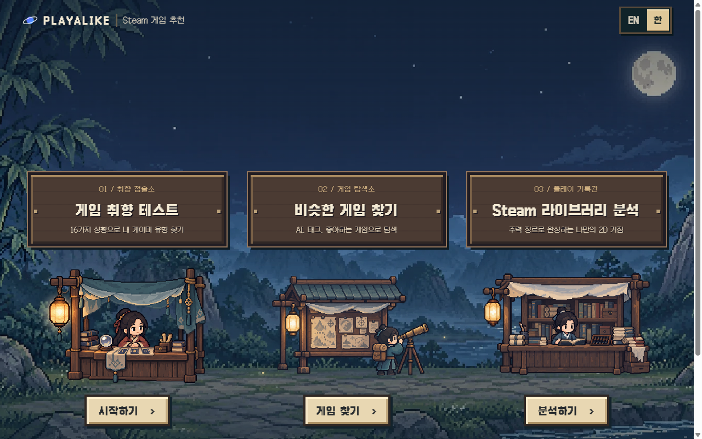
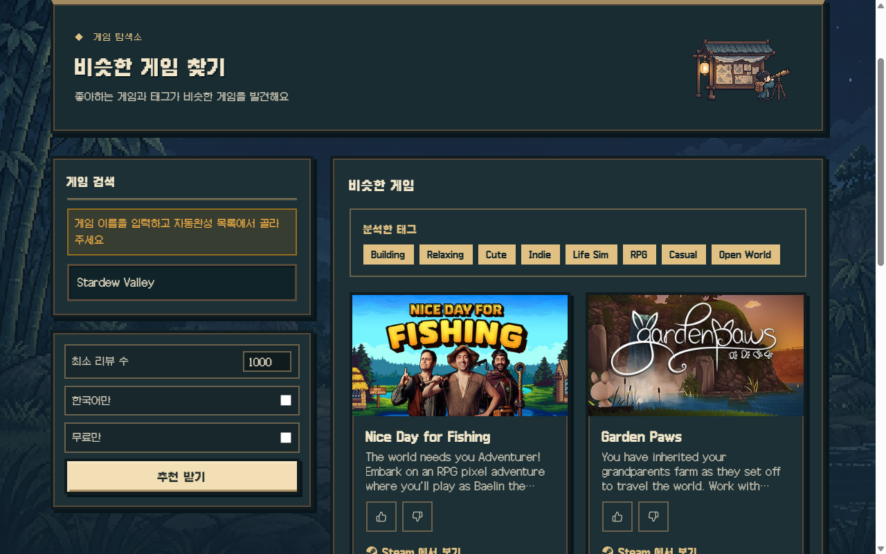
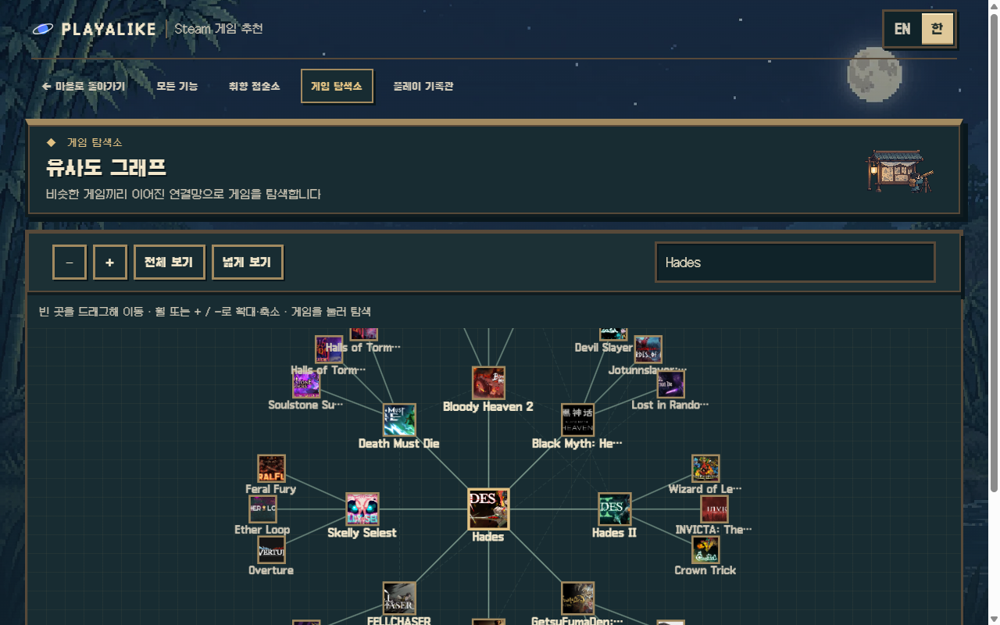
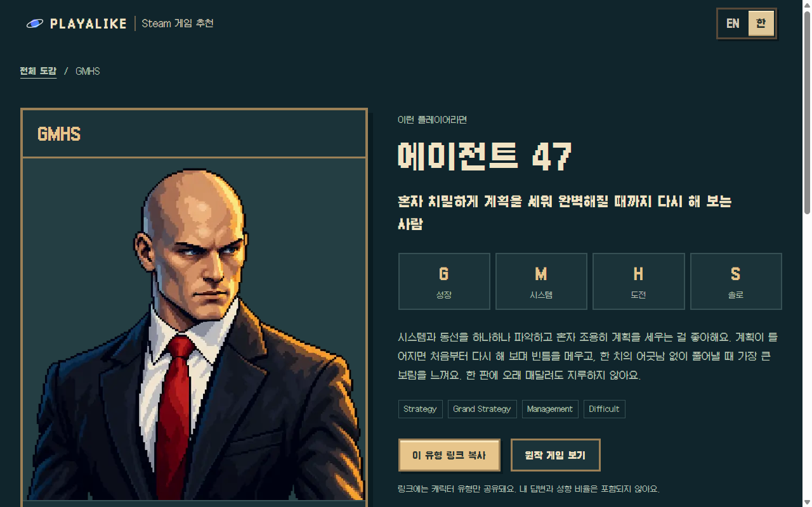
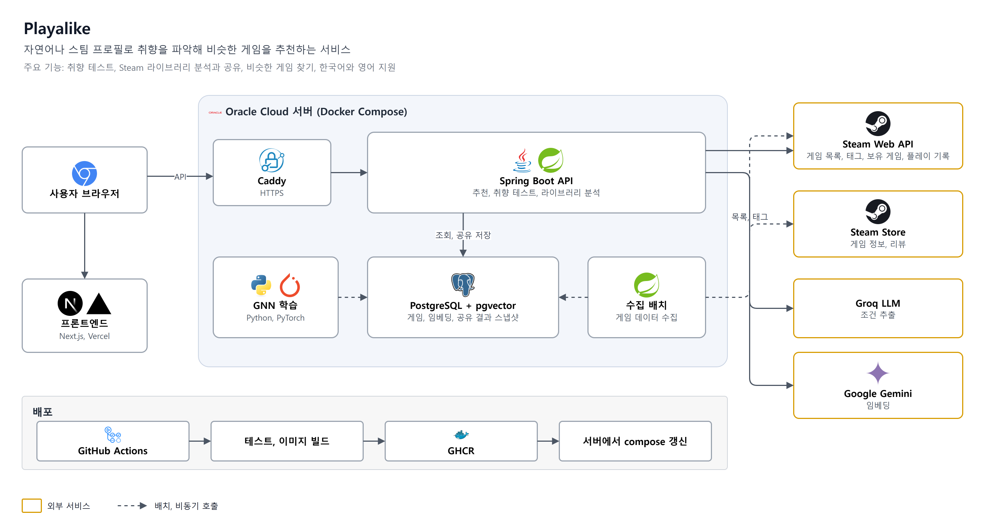
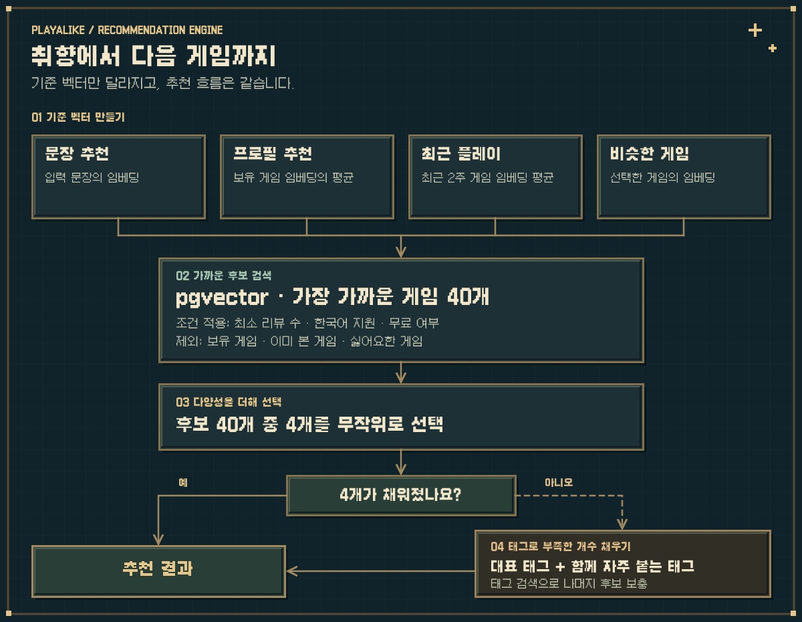

[English](README.md) | **한국어**

# Playalike: Steam 게임 추천

좋아하는 게임이나 원하는 게임을 설명한 문장을 입력하면 취향에 맞는 Steam 게임을 추천합니다. Steam ID를 입력해 보유 게임과 최근 플레이 기록으로 추천받을 수도 있습니다.

- [서비스 바로가기](https://playalike.online) — 한국어, 영어 지원
- 리뷰가 50개 이상인 게임을 수집합니다. 리뷰 수가 적은 게임은 검색 결과에 없을 수 있습니다.



---

## 주요 기능

### 게임 찾기

- **태그로 랜덤 추천** (`/steam/random`): 선택한 태그가 붙은 게임을 무작위로 추천합니다. 최소 리뷰 수, 한국어 지원, 무료 여부로 필터링할 수 있습니다.
- **문장으로 추천** (`/steam/input`): "친구와 가볍게 할 협동 게임"처럼 원하는 게임을 설명하면 문장과 비슷한 게임을 찾습니다.
- **조건 맞춤 추천** (`/steam/match`): 설명에 플레이 시간, 예산, 인원 조건을 더해 추천받습니다. 게임마다 추천 이유와 주의할 점을 함께 보여 줍니다.
- **비슷한 게임** (`/steam/similar`): 좋아하는 게임 하나를 기준으로 비슷한 게임을 찾습니다.
- **유사도 그래프** (`/steam/graph`): 비슷한 게임을 그래프로 둘러봅니다. 게임을 누르면 연결된 추천 게임이 펼쳐집니다.

### Steam 플레이 기록으로 추천받기

공개 Steam 프로필이 필요합니다.

- **프로필 추천** (`/steam/profile`): 보유 게임 전체를 바탕으로 취향에 맞는 새 게임을 추천합니다.
- **최근 플레이 추천** (`/steam/recent`): 최근 2주 동안 플레이한 게임을 기준으로 추천합니다.
- **라이브러리 분석** (`/library`): 플레이 시간이 가장 긴 장르에 맞춰 2D 거점을 꾸미고, 지금 해볼 게임과 다시 켤 게임, 잘 맞지 않는 장르를 보여 줍니다. 분석 결과는 프로필 정보 없이 링크로 공유할 수 있습니다.

### 취향 테스트와 미니게임

- **취향 테스트** (`/taste`): 16개 질문으로 탐험/성장, 서사/시스템, 여유/도전, 파티/솔로 성향을 살펴봅니다. 결과는 16개 유형 중 하나로 나오며, 유형에 맞는 게임도 추천합니다.
- **게임 선택** (`/steam/choice`): 두 게임 중 더 마음에 드는 쪽을 7번 고르며 취향을 알아봅니다.
- **리뷰 맞히기** (`/steam/review-guess`): 실제 Steam 리뷰를 읽고 어떤 게임인지 맞힙니다.

추천 카드에서 좋아요와 싫어요를 남길 수 있습니다. 싫어요를 누른 게임은 이후 추천에서 제외합니다.

<p>
  
  
</p>
<p>
  
</p>

---

## 전체 구조



프론트엔드는 Next.js로 만들고 Vercel에 배포했습니다. Spring Boot 백엔드와 PostgreSQL, 게임 수집 배치, GNN 학습 배치는 Oracle Cloud 서버 한 대에서 Docker Compose로 실행하며, Caddy가 HTTPS를 처리합니다.

Steam Web API와 Steam 상점에서 게임 정보를 수집합니다. 문장에서 추천 조건을 추출할 때는 Groq LLM을, 임베딩을 만들 때는 Google Gemini를 사용합니다. Groq 호출이 실패하면 Gemini로 조건을 추출합니다.

### 게임 데이터 수집과 학습

추천에 사용할 데이터는 다음 순서로 준비합니다.

1. Steam 게임 목록을 가져오고, 태그끼리 함께 등장하는 빈도를 다시 집계합니다.
2. 각 게임의 Steam 상점 페이지에서 설명, 태그, 리뷰를 수집합니다.
3. 설명과 태그로 임베딩을 생성합니다.
4. 별도의 GNN 학습 배치에서 태그 구성 벡터를 생성합니다.

---

## 추천 로직

게임 설명의 유사도를 비교할 때는 Gemini 임베딩과 pgvector를 사용합니다.

- **임베딩**: 게임 설명과 태그를 숫자 768개로 표현한 벡터입니다. 내용이 비슷한 게임의 벡터가 서로 가까워지는 성질을 이용해 추천 후보를 찾습니다.
- **pgvector**: PostgreSQL에서 벡터를 저장하고 가까운 벡터를 검색하는 확장입니다.

### 1. 공통 추천 흐름

문장, 프로필, 최근 플레이, 비슷한 게임 추천은 기준 벡터를 정한 뒤 가까운 게임을 찾습니다. 추천 방식에 따라 기준 벡터가 달라집니다.



1. **기준 벡터**: 문장 추천은 입력 문장의 임베딩을 사용합니다. 프로필 추천은 보유 게임의 임베딩 평균, 최근 플레이 추천은 최근 2주 동안 플레이한 게임의 임베딩 평균을 사용합니다. 비슷한 게임 추천은 선택한 게임의 임베딩이 기준입니다.
2. **후보 검색**: 기준 벡터와 가까운 게임 40개를 찾습니다. 최소 리뷰 수, 한국어 지원, 무료 여부를 적용하고 보유 게임, 이미 보여 준 게임, 싫어요를 누른 게임은 제외합니다.
3. **무작위 선택**: 후보 중 4개를 무작위로 추천합니다. 가장 가까운 게임만 고르면 다시 추천받을 때 같은 결과가 반복되기 때문입니다.
4. **태그로 보충**: 조건에 맞는 게임이 4개보다 적으면 추천 기준의 대표 태그와 자주 함께 등장하는 태그로 검색해 나머지를 채웁니다.

### 2. 비슷한 게임 추천

게임 설명이 비슷해도 실제 플레이 방식은 다를 수 있어, 태그 구성도 함께 비교합니다.

- **설명 유사도**: 위에서 설명한 임베딩으로 비교합니다.
- **태그 유사도**: 게임과 태그를 연결한 그래프를 GNN(그래프 신경망, GCN 모델)으로 학습합니다. 태그 조합이 비슷한 게임끼리 가까운 벡터를 갖게 됩니다.

태그 기준으로는 비슷한 게임 30개를 찾은 뒤, 유사도 순위와 인기 순위를 평균 내 상위 10개를 남깁니다. 유사도만 보면 잘 알려지지 않은 게임에 치우치고, 인기만 보면 다른 장르의 대작이 포함될 수 있어 두 순위를 함께 반영합니다.

두 후보 목록에서는 **Team Draft 인터리빙**으로 번갈아 한 게임씩 선택합니다. 각 게임이 어느 목록에서 왔는지 기록해 사용자가 어느 쪽 추천을 더 많이 클릭하는지 비교합니다.

`app.recommend.similar-interleave-enabled` 설정으로 인터리빙을 켜거나 끌 수 있습니다. 꺼져 있으면 설명 유사도만 사용합니다.

### 3. 조건 맞춤 추천

조건 맞춤 추천은 문장뿐 아니라 폼에 입력한 조건도 함께 반영합니다.

1. **조건 해석**: LLM이 설명 문장에서 조건을 추출하고 폼의 플레이 시간, 예산, 인원, 최소 리뷰 수와 합칩니다. 문장과 폼 값이 충돌하면 폼 값을 우선합니다.
2. **후보 검색**: 문장에 "편안한" 같은 분위기 표현이 있으면 이를 임베딩해 가까운 게임을 찾습니다. 분위기 표현이 없으면 평가가 좋은 게임을 모읍니다. 예산, 협동 지원, 인원, 제외할 태그 조건으로 후보를 필터링합니다.
3. **추천 선택**: 플레이 시간을 지정했다면 그에 맞는 게임을 우선합니다. 이전에 좋아요를 누른 게임과 비슷한 후보는 선택될 확률을 높입니다.
4. **후보 보충**: 추천 개수가 부족하면 최소 리뷰 수를 낮춰 한 번 더 검색합니다.
5. **추천 이유 표시**: 충족한 조건, 좋아요를 누른 게임과의 유사점, 주의할 점을 게임마다 표시합니다.

---

## 라이브러리 분석

Steam ID로 보유 게임과 게임별 플레이 시간을 가져와 취향을 분석하고 2D 거점에 반영합니다.

- **성향**: 태그별 플레이 시간 비율을 계산합니다.
- **거점 배경**: 게임마다 대표 장르를 하나 정해 플레이 시간을 합산합니다. 총 플레이 시간이 가장 긴 장르가 거점의 배경이 됩니다.

플레이 기록을 바탕으로 다음 항목도 보여 줍니다.

- **지금 해볼 게임**: 보유했지만 아직 플레이하지 않은 게임 중, 오래 플레이한 게임의 태그와 겹치고 평가가 좋은 게임
- **다시 켤 게임**: 오래 플레이했지만 한동안 실행하지 않은 게임
- **안 맞는 장르**: 잠깐 플레이하고 그만둔 게임이 가장 많이 모인 장르

분석 결과를 공유 링크로 저장하면 프로필 정보 없이 다른 사람에게 보여 줄 수 있습니다. 공유 결과는 90일 동안 보관합니다.

---

## 프로젝트 구조

```
SteamGame_Recommend/
├── backend/                     # Spring Boot API (Java 17)
│   ├── src/main/java/SteamGame/recommend/
│   │   ├── controller/          # REST 컨트롤러
│   │   ├── domain/              # 추천, 취향 테스트, 라이브러리 분석, 그래프, 미니게임, 피드백, 지표
│   │   └── infra/               # Steam 수집, 임베딩, LLM(Groq, Gemini), 외부 API, 요청 제한
│   ├── src/main/resources/
│   │   ├── db/migration/        # Flyway 마이그레이션
│   │   ├── taste/               # 취향 테스트 질문과 유형 데이터
│   │   └── library/             # 라이브러리 분석 문구 데이터
│   ├── docker-compose.yml       # 로컬 PostgreSQL(pgvector)
│   └── docker-compose.prod.yml  # 운영: postgres, app, caddy, GNN 학습 배치
├── frontend/                    # Next.js 16, React 19 (한국어, 영어)
├── ml/tag_embedding/            # GNN 학습 배치 (PyTorch Geometric)
└── assets/readme/               # README 이미지
```

---

## 기술 스택

- **Backend**: Java 17, Spring Boot 3.4, Spring Data JPA, Spring Security, Flyway, Resilience4j, Bucket4j
- **Database**: PostgreSQL 16, pgvector
- **Frontend**: Next.js 16, React 19, TypeScript, Cytoscape.js, Vitest
- **ML**: PyTorch Geometric (GCN)
- **AI**: Gemini 임베딩, Groq와 Gemini LLM
- **Infra**: Oracle Cloud, Docker Compose, Caddy, GitHub Actions, GHCR, Vercel

---

## 문의

문제는 [Issues](https://github.com/tember8003/SteamGame_Recommend/issues)에 남겨 주세요.
