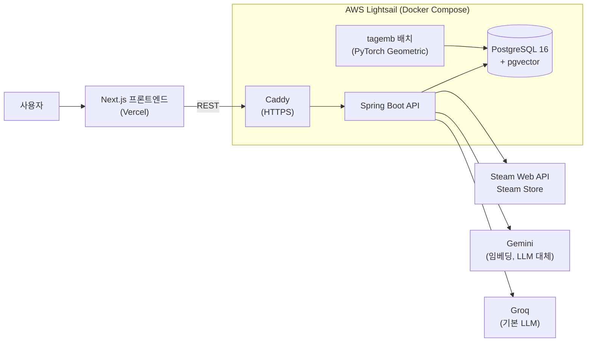
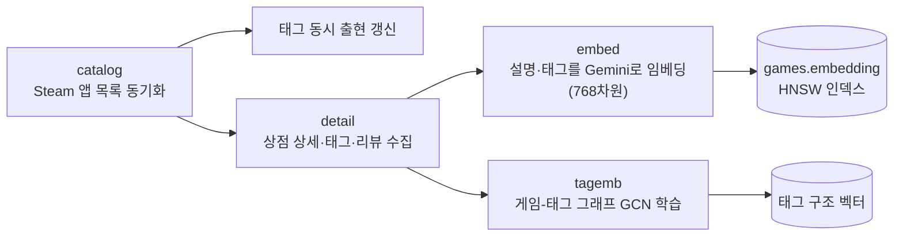
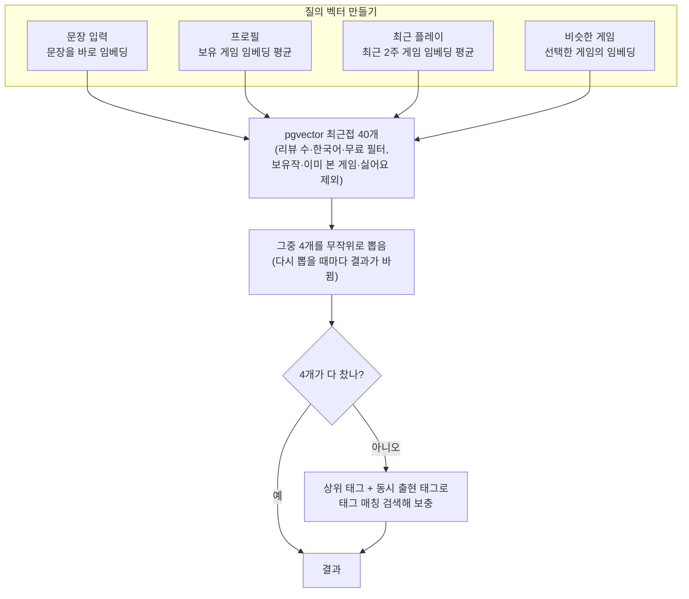
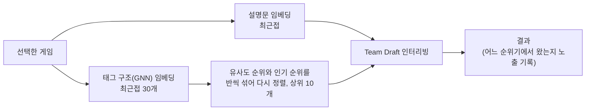
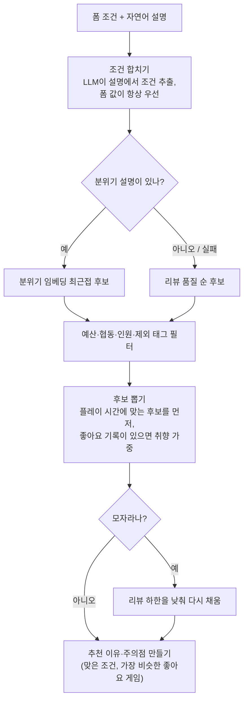
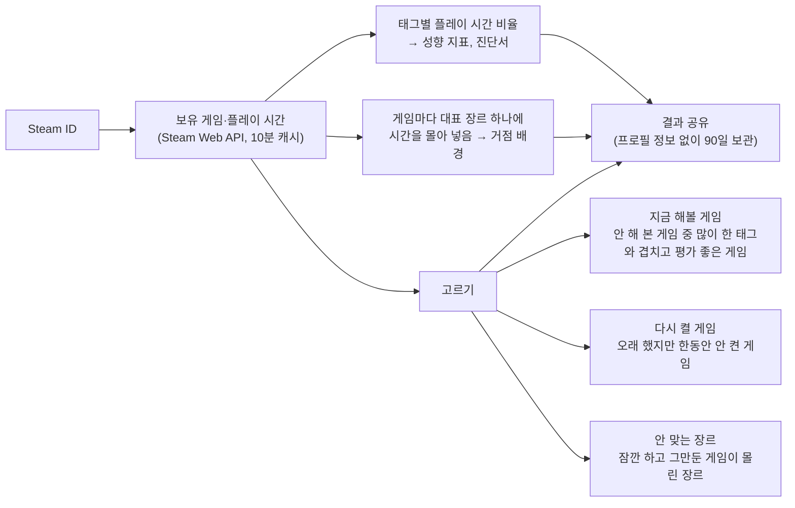

[English](README.md) | **한국어**

# Playalike: Steam 게임 추천

태그, 설명 문장, Steam 프로필·라이브러리, 게임 임베딩을 이용해 다음에 할 Steam 게임을 찾아 주는 서비스입니다.

- 서비스: https://playalike.online (한국어 / English)
- 백엔드: Spring Boot REST API + PostgreSQL(pgvector)
- 프론트엔드: Next.js (Vercel 배포)

> 수집 대상은 리뷰 50개 이상인 게임입니다(`app.crawler.min-reviews`). 리뷰가 적은 게임은 검색되지 않을 수 있습니다.


---

## 주요 기능

| 기능 | 화면 | 설명 |
| --- | --- | --- |
| 태그 랜덤 추천 | `/steam/random` | 고른 태그로 랜덤 추천, 리뷰 수·한국어 지원·무료 필터 |
| 문장 입력 추천 | `/steam/input` | 원하는 게임을 문장으로 설명하면 그 문장과 가까운 게임 추천 |
| 조건 맞춤 추천 | `/steam/match` | 설명 + 플레이 시간·예산·인원 조건, 추천 이유와 주의점 제공 |
| 프로필 추천 | `/steam/profile` | Steam ID의 보유 게임으로 취향 분석 (공개 프로필만) |
| 최근 플레이 추천 | `/steam/recent` | 최근 2주 플레이 기록 기반 추천 |
| 비슷한 게임 | `/steam/similar` | 좋아하는 게임과 가까운 게임 추천 |
| 유사도 그래프 | `/steam/graph` | 비슷한 게임끼리 연결된 네트워크 탐색 (Cytoscape) |
| 라이브러리 분석 | `/library` | 플레이 기록으로 장르 거점을 만들고, 지금 해볼 게임·다시 켤 게임·안 맞는 장르를 보여 줌, 프로필 없이 결과 공유 |
| 취향 테스트 | `/taste` | 16문항에 답하면 4개 축(탐험/성장, 서사/시스템, 여유/도전, 파티/솔로) 기준 16개 유형 중 하나와 맞춤 게임 제공 |
| 게임 선택 | `/steam/choice` | 7라운드 양자택일로 취향 파악 |
| 리뷰 맞히기 | `/steam/review-guess` | 실제 Steam 리뷰를 보고 어떤 게임인지 맞히는 미니게임 |

추천 카드마다 좋아요/싫어요 피드백을 받고, 노출·피드백·퍼널 이벤트는 내부 지표 화면(`/metrics`, 토큰 필요)에서 봅니다.

| 비슷한 게임 | 유사도 그래프 |
| --- | --- |
|  |  |

| 취향 테스트 유형 |
| --- |
|  |

---

## 전체 구조



### 데이터 준비 흐름



---

## 추천 로직

### 공통 뼈대: 질의 벡터 → 최근접 후보 → 태그로 보충

문장 입력, 프로필, 최근 플레이, 비슷한 게임 추천은 질의 벡터만 다르고 같은 경로를 탑니다.



- 문장 입력은 LLM으로 태그도 뽑아 화면에 보여 주고, 임베딩이 실패하면 그 태그로 검색합니다.
- LLM은 Groq(`openai/gpt-oss-20b`)를 먼저 쓰고 실패하면 Gemini로 넘어갑니다. 같은 문장의 결과는 캐시합니다.

### 비슷한 게임: 두 순위기 섞기

`app.recommend.similar-interleave-enabled`를 켜면 설명문 임베딩과 GNN 태그 구조 임베딩 결과를 섞습니다.



GNN 쪽 조회가 실패하면 설명문 쪽 결과만 내고, 둘 다 비면 공통 경로로 내려갑니다. 노출마다 출처를 기록해 두 순위기를 비교합니다.

### 조건 맞춤 추천



### 라이브러리 분석



분석 계산은 DB·시간·난수 없이 순수 함수로 짜여 있어 테스트로 판정 기준을 고정해 두었습니다.

---

## 프로젝트 구조

```
SteamGame_Recommend/
├── backend/                     # Spring Boot API (Java 17)
│   ├── src/main/java/SteamGame/recommend/
│   │   ├── controller/          # REST 컨트롤러
│   │   ├── domain/              # recommendation, taste, library, graph, choice, guess, feedback, event, metrics ...
│   │   └── infra/               # crawler(Steam 수집), embedding, llm(Groq/Gemini), api, web(rate limit)
│   ├── src/main/resources/
│   │   ├── db/migration/        # Flyway 마이그레이션 (V1~V9)
│   │   ├── taste/               # 취향 테스트 질문·유형 데이터
│   │   ├── library/             # 라이브러리 분석 문구 데이터
│   │   └── static/              # 예전 HTML UI (현재 화면은 frontend)
│   ├── docker-compose.yml       # 로컬 PostgreSQL(pgvector)
│   ├── docker-compose.prod.yml  # 운영: postgres + app + caddy (+ tagemb 배치)
│   └── Caddyfile, Dockerfile
├── frontend/                    # Next.js 16 + React 19, ko/en
│   ├── app/[locale]/            # steam/*, library, taste 화면
│   ├── components/, lib/
│   └── public/                  # 픽셀 아트 이미지, 폰트
├── ml/tag_embedding/            # PyTorch Geometric GCN 학습 배치
├── assets/readme/               # README 이미지
└── .github/workflows/deploy.yml # 테스트, 이미지 빌드, 배포
```

---

## 기술 스택

- **Backend**: Java 17, Spring Boot 3.4 (Web, WebFlux, Data JPA, Security, Validation, Actuator), Flyway, Resilience4j, Bucket4j + Caffeine, springdoc-openapi
- **Database**: PostgreSQL 16 + pgvector
- **Frontend**: Next.js 16, React 19, TypeScript, Cytoscape.js, Vitest
- **ML**: PyTorch Geometric (GCN)
- **AI**: Gemini Embedding, Groq / Gemini 채팅 완성
- **Infra**: Docker Compose, Caddy, AWS Lightsail, GitHub Actions, GHCR, Vercel

---

## 문의

문제는 [Issues](https://github.com/tember8003/SteamGame_Recommend/issues)에 남겨 주세요.
