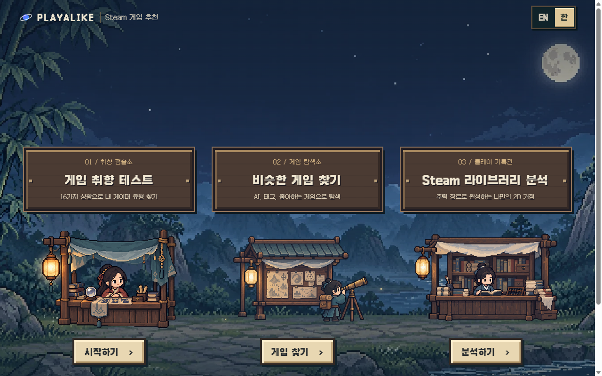
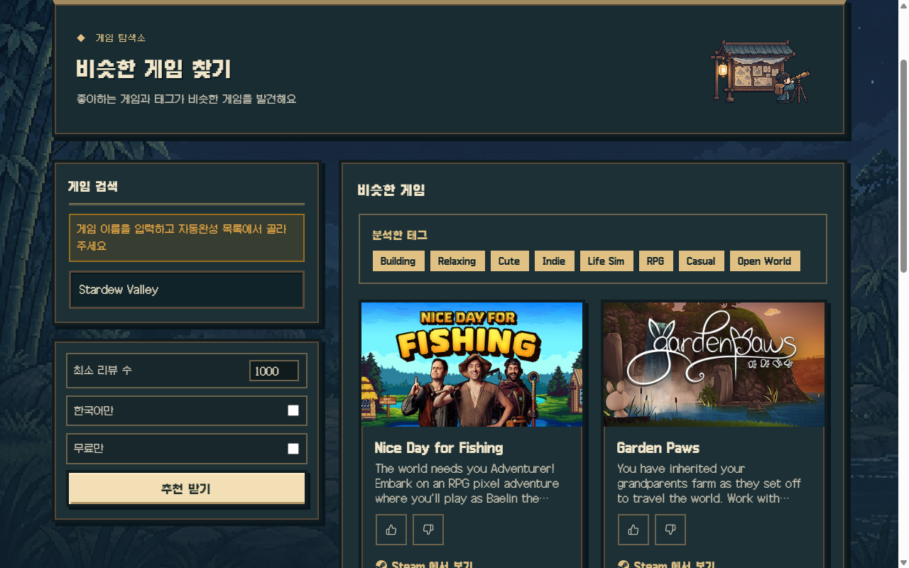
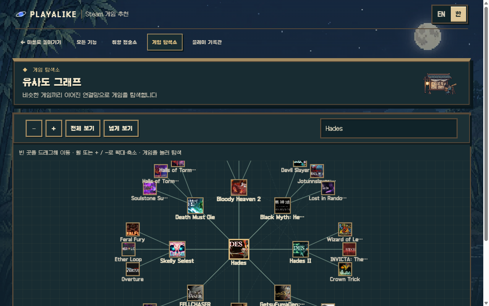
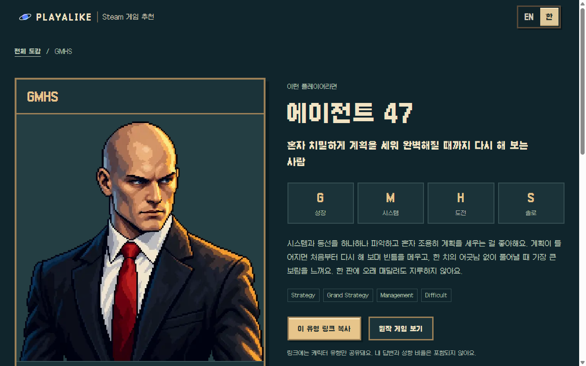
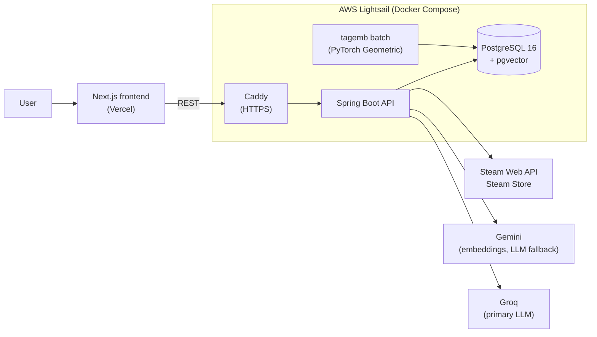
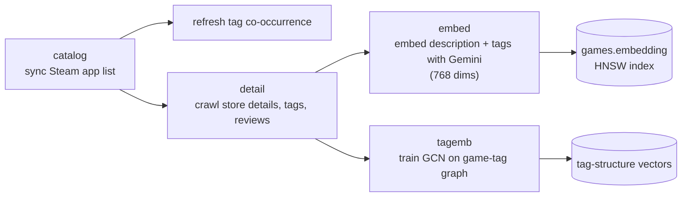
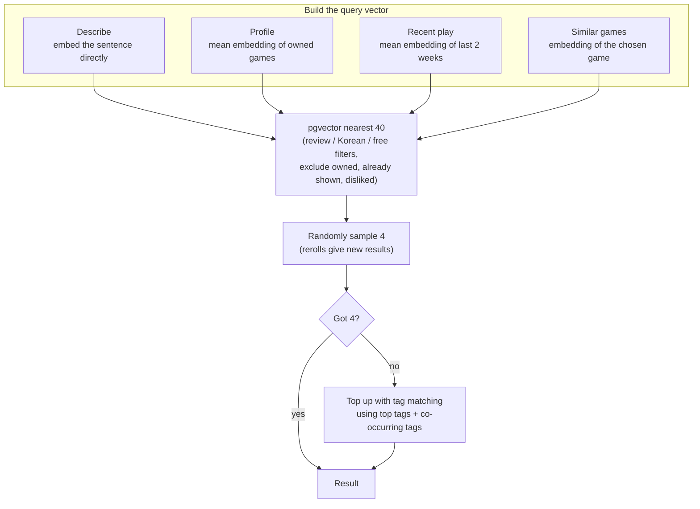
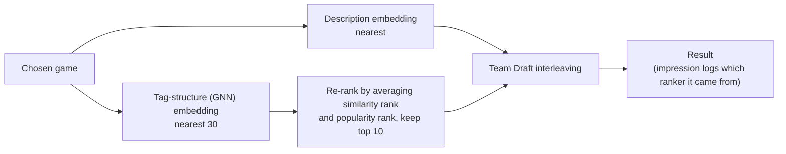
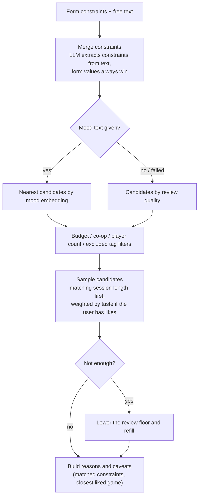
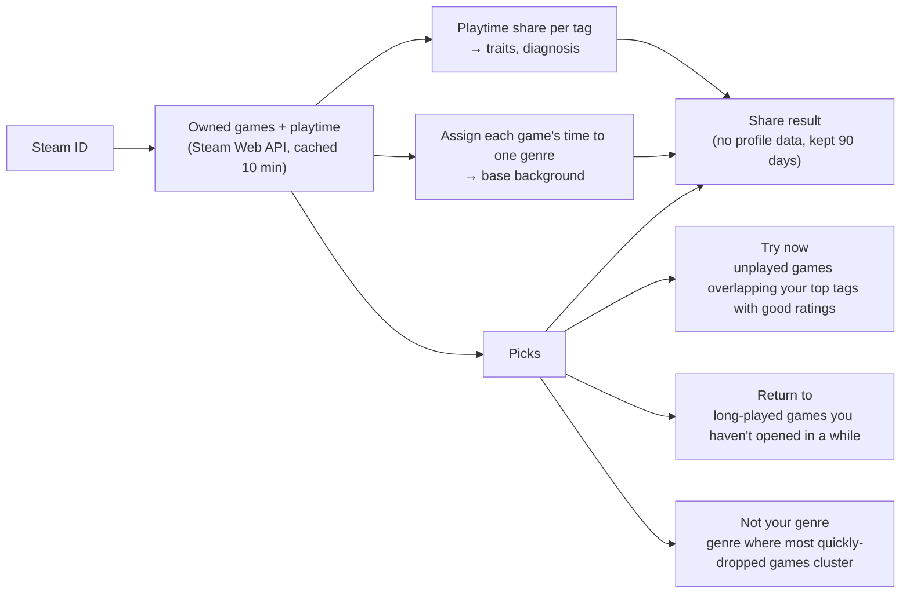

**English** | [한국어](README.ko.md)

# Playalike: Steam Game Recommendations

A service that helps you find your next Steam game using tags, free-text descriptions, your Steam profile and library, and game embeddings.

- Live: https://playalike.online (Korean / English)
- Backend: Spring Boot REST API + PostgreSQL (pgvector)
- Frontend: Next.js (deployed on Vercel)

> Only games with 50+ reviews are collected (`app.crawler.min-reviews`), so games with few reviews may not show up.



---

## Features

| Feature | Page | Description |
| --- | --- | --- |
| Random by tag | `/steam/random` | Random picks from selected tags, with review count / Korean support / free-only filters |
| Describe a game | `/steam/input` | Describe what you want and get games close to that sentence |
| Requirement match | `/steam/match` | Description plus session length, budget and player count; each pick comes with reasons and caveats |
| Profile | `/steam/profile` | Analyzes the games owned by a Steam ID (public profiles only) |
| Recent play | `/steam/recent` | Recommendations from the last two weeks of play |
| Similar games | `/steam/similar` | Games close to a game you like |
| Similarity graph | `/steam/graph` | Explore games as a network of similar titles (Cytoscape) |
| Library analysis | `/library` | Builds a genre base from your play history, shows games to try now, games worth returning to, and genres that don't fit; shareable without exposing the profile |
| Taste test | `/taste` | 16 questions place you in one of 16 types across 4 axes (explore/growth, narrative/system, relaxed/challenge, party/solo), plus matching games |
| Game choice | `/steam/choice` | Pick one of two games for 7 rounds to find your taste |
| Review guess | `/steam/review-guess` | Mini game: guess the game from real Steam reviews |

Every recommendation card collects thumbs up/down feedback. Impressions, feedback and funnel events are shown on an internal metrics page (`/metrics`, token required).

| Similar games | Similarity graph |
| --- | --- |
|  |  |

| Taste test type |
| --- |
|  |

---

## Architecture



### Data Pipeline



---

## Recommendation Logic

### Common path: query vector → nearest candidates → tag top-up

Describe, profile, recent play and similar games share one path; only the query vector differs.



- For descriptions, an LLM also extracts tags to display; if embedding fails, those tags are used for search.
- Groq (`openai/gpt-oss-20b`) is tried first, then Gemini. Results for the same sentence are cached.

### Similar games: interleaving two rankers

With `app.recommend.similar-interleave-enabled`, results from description embeddings and GNN tag-structure embeddings are mixed.



If the GNN lookup fails, only description results are returned; if both are empty, the common path is used. Each impression records its source so the two rankers can be compared.

### Requirement match



### Library analysis



The analysis is written as pure functions (no DB, clock or randomness), so the rules are pinned down by tests.

---

## Project Structure

```
SteamGame_Recommend/
├── backend/                     # Spring Boot API (Java 17)
│   ├── src/main/java/SteamGame/recommend/
│   │   ├── controller/          # REST controllers
│   │   ├── domain/              # recommendation, taste, library, graph, choice, guess, feedback, event, metrics ...
│   │   └── infra/               # crawler (Steam), embedding, llm (Groq/Gemini), api, web (rate limit)
│   ├── src/main/resources/
│   │   ├── db/migration/        # Flyway migrations (V1–V9)
│   │   ├── taste/               # Taste test questions and types
│   │   ├── library/             # Library analysis copy
│   │   └── static/              # Legacy HTML UI (current UI lives in frontend)
│   ├── docker-compose.yml       # Local PostgreSQL (pgvector)
│   ├── docker-compose.prod.yml  # Prod: postgres + app + caddy (+ tagemb batch)
│   └── Caddyfile, Dockerfile
├── frontend/                    # Next.js 16 + React 19, ko/en
│   ├── app/[locale]/            # steam/*, library, taste pages
│   ├── components/, lib/
│   └── public/                  # Pixel art images, fonts
├── ml/tag_embedding/            # PyTorch Geometric GCN training batch
├── assets/readme/               # README images
└── .github/workflows/deploy.yml # Test, build image, deploy
```

---

## Tech Stack

- **Backend**: Java 17, Spring Boot 3.4 (Web, WebFlux, Data JPA, Security, Validation, Actuator), Flyway, Resilience4j, Bucket4j + Caffeine, springdoc-openapi
- **Database**: PostgreSQL 16 + pgvector
- **Frontend**: Next.js 16, React 19, TypeScript, Cytoscape.js, Vitest
- **ML**: PyTorch Geometric (GCN)
- **AI**: Gemini Embedding, Groq / Gemini chat completion
- **Infra**: Docker Compose, Caddy, AWS Lightsail, GitHub Actions, GHCR, Vercel

---

## Support

Please report issues on the [Issues page](https://github.com/tember8003/SteamGame_Recommend/issues).
