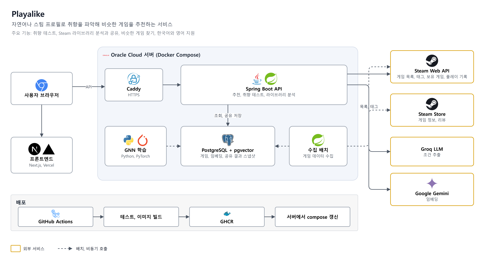
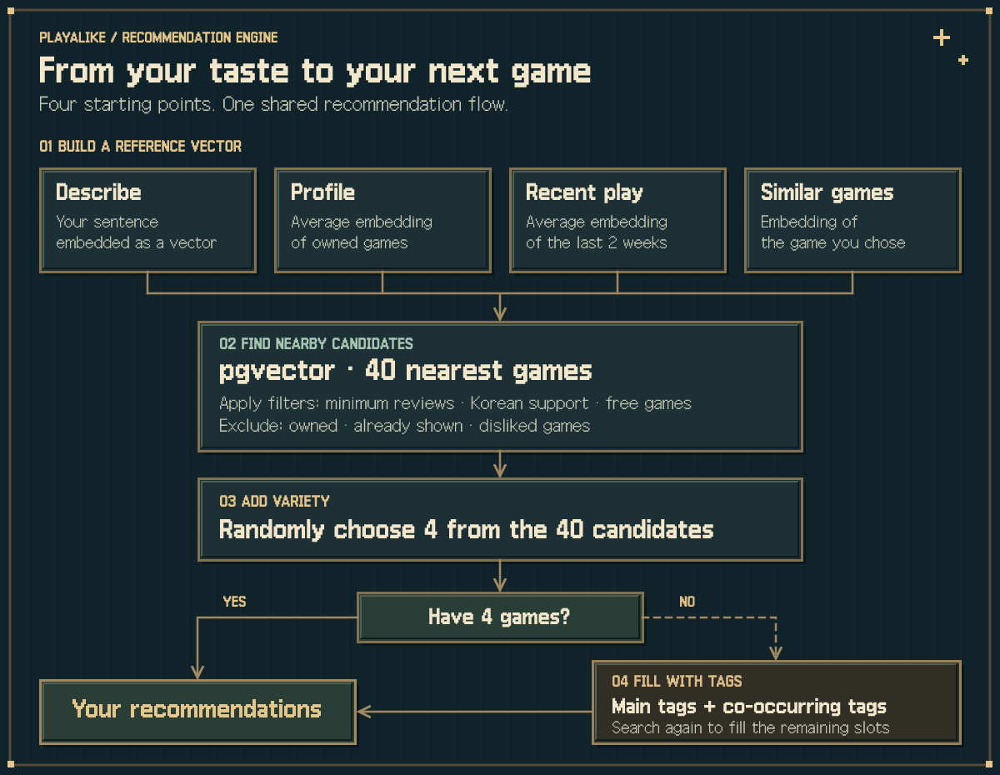

**English** | [한국어](README.ko.md)

# Playalike: Steam Game Recommendations

Find Steam games from a game you like or a description of what you want to play. Enter a Steam ID to get recommendations from your library and recent play history.

- [Try Playalike](https://playalike.online) — available in Korean and English
- The catalog includes games with 50+ reviews. Games with fewer reviews may be missing from search results.


---

## Features

### Find games

- **Random by tag** (`/steam/random`): Get random games with your selected tags. Filter by minimum reviews, Korean language support, and whether the game is free.
- **Describe a game** (`/steam/input`): Describe what you want, such as "a light co-op game to play with a friend", to find matching games.
- **Requirement match** (`/steam/match`): Add session length, budget, and player count to your description. Each recommendation includes reasons and caveats.
- **Similar games** (`/steam/similar`): Choose a game you like to find similar ones.
- **Similarity graph** (`/steam/graph`): Browse connections between similar games. Click a game to expand its recommendations.

### Use your Steam history

These features require a public Steam profile.

- **Profile** (`/steam/profile`): Get recommendations for new games based on your whole library.
- **Recent play** (`/steam/recent`): Get recommendations based on games you played in the last two weeks.
- **Library analysis** (`/library`): Your most-played genre sets the scene for a 2D base. The report suggests games to try, games to return to, and genres that may not suit you. Share the report by link without exposing your profile information.

### Taste tests and mini-games

- **Taste test** (`/taste`): Answer 16 questions about exploration/growth, narrative/systems, relaxation/challenge, and party/solo play. Get one of 16 types, along with games that fit it.
- **Game choice** (`/steam/choice`): Choose between two games over seven rounds to explore your preferences.
- **Review guess** (`/steam/review-guess`): Read real Steam reviews and guess the game.

Leave a thumbs up or down on recommendation cards. Games you dislike are excluded from future recommendations.

<p>
  
  
</p>
<p>
  
</p>

---

## Architecture



The Next.js frontend is hosted on Vercel. The Spring Boot backend, PostgreSQL database, game collection jobs, and GNN training jobs run on one Oracle Cloud server with Docker Compose. Caddy handles HTTPS.

Game data comes from the Steam Web API and the Steam store. Groq LLM extracts recommendation constraints from text, and Google Gemini generates embeddings. If a Groq call fails, Gemini handles constraint extraction instead.

### Data collection and training

Data for recommendations is prepared in this order:

1. Fetch the Steam game list and recalculate how often tags appear together.
2. Collect each game's description, tags, and reviews from its Steam store page.
3. Generate embeddings from descriptions and tags.
4. Run a separate GNN training job to generate tag-structure vectors.

---

## Recommendation Logic

Description similarity is measured with Gemini embeddings and searched with pgvector.

- **Embedding**: A vector of 768 numbers representing a game's description and tags. Similar content produces nearby vectors, which lets us search for recommendation candidates.
- **pgvector**: A PostgreSQL extension for storing vectors and finding their nearest neighbors.

### 1. Shared recommendation flow

Description, profile, recent-play, and similar-game recommendations start with a reference vector and search for nearby games. Each mode builds that reference differently.



1. **Reference vector**: Description mode embeds your sentence. Profile mode averages the embeddings of your owned games; recent-play mode averages those of games played in the last two weeks. Similar-game mode uses the selected game's embedding.
2. **Candidate search**: Find the 40 nearest games. Apply minimum-review, Korean language, and free-game filters, then exclude owned, already shown, and disliked games.
3. **Random selection**: Choose 4 candidates at random. Always choosing the nearest games would repeat the same results when you ask again.
4. **Tag fallback**: If fewer than 4 games match, fill the remaining slots using the reference's main tags and tags that often appear alongside them.

### 2. Similar games

Games with similar descriptions can play differently, so recommendations also compare their tag combinations.

- **Description similarity**: Uses the embeddings described above.
- **Tag similarity**: A GNN (graph neural network, GCN model) learns from a graph connecting games and tags. Games with similar tag combinations receive nearby vectors.

The tag search finds 30 similar games, averages their similarity and popularity ranks, and keeps the top 10. Similarity alone can favor little-known games, while popularity alone can pull in hits from other genres.

**Team Draft interleaving** takes one game from each candidate list in turn. Each game records its source list so we can compare which recommendations users click more often.

The `app.recommend.similar-interleave-enabled` setting controls interleaving. When disabled, recommendations use description similarity alone.

### 3. Requirement match

Requirement match combines your description with the conditions entered in the form.

1. **Parse constraints**: An LLM extracts constraints from your description and combines them with the form's session length, budget, player count, and minimum reviews. Form values take precedence when they conflict with the text.
2. **Find candidates**: If the text describes a mood, such as "relaxing", embed it to find nearby games. Otherwise, start with well-rated games. Filter candidates by budget, co-op support, player count, and excluded tags.
3. **Select recommendations**: Prioritize games that fit your session length, if specified. Candidates similar to games you previously liked have a higher chance of selection.
4. **Refill**: If there are too few recommendations, lower the minimum review count and search once more.
5. **Show reasons**: Explain which conditions each game meets, how it resembles games you liked, and any caveats.

---

## Library Analysis

Using a Steam ID, the service fetches owned games and playtime to build a taste report and a 2D base.

- **Traits**: Calculate each tag's share of playtime.
- **Base background**: Assign each game one main genre and add up playtime by genre. The genre with the most playtime determines the background.

The report also includes:

- **Try now**: Well-rated, unplayed games you own that share tags with games you spent time on
- **Return to**: Games you played a lot but haven't launched in a while
- **Not your genre**: The genre containing the most games you dropped after a short time

Save the report as a share link to show it to others without including your profile information. Shared reports are kept for 90 days.

---

## Project Structure

```
SteamGame_Recommend/
├── backend/                     # Spring Boot API (Java 17)
│   ├── src/main/java/SteamGame/recommend/
│   │   ├── controller/          # REST controllers
│   │   ├── domain/              # recommendation, taste test, library analysis, graph, mini games, feedback, metrics
│   │   └── infra/               # Steam crawler, embeddings, LLM (Groq, Gemini), external APIs, rate limiting
│   ├── src/main/resources/
│   │   ├── db/migration/        # Flyway migrations
│   │   ├── taste/               # Taste test questions and types
│   │   └── library/             # Library analysis copy
│   ├── docker-compose.yml       # Local PostgreSQL (pgvector)
│   └── docker-compose.prod.yml  # Prod: postgres, app, caddy, GNN training batch
├── frontend/                    # Next.js 16, React 19 (Korean, English)
├── ml/tag_embedding/            # GNN training batch (PyTorch Geometric)
└── assets/readme/               # README images
```

---

## Tech Stack

- **Backend**: Java 17, Spring Boot 3.4, Spring Data JPA, Spring Security, Flyway, Resilience4j, Bucket4j
- **Database**: PostgreSQL 16, pgvector
- **Frontend**: Next.js 16, React 19, TypeScript, Cytoscape.js, Vitest
- **ML**: PyTorch Geometric (GCN)
- **AI**: Gemini embeddings, Groq and Gemini LLMs
- **Infra**: Oracle Cloud, Docker Compose, Caddy, GitHub Actions, GHCR, Vercel

---

## Support

Please report issues on the [Issues page](https://github.com/tember8003/SteamGame_Recommend/issues).
